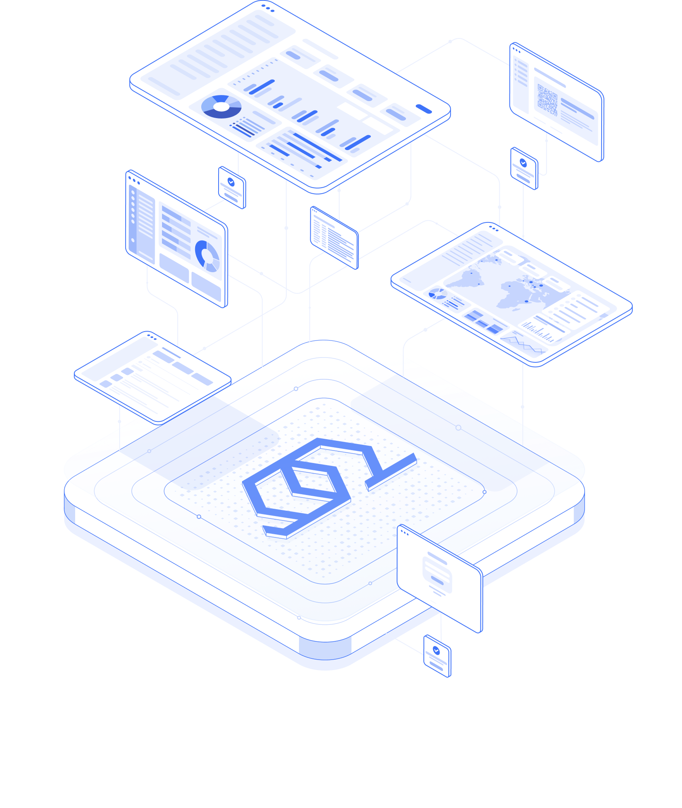

<div align="center">


### Multi-node VPN management panel for xray, sing-box, hysteria, and WireGuard

FastAPI + PostgreSQL + Redis backend · Next.js admin console · pull-based node agent

[](LICENSE)
[](pyproject.toml)
[](web/package.json)
[](#features)
[](#quick-start)

<br />



</div>

---

XLink is a self-hosted control plane for running a fleet of VPN nodes from a
single console. You define **users** (with data, expiry, on-hold and device
limits), attach them to **profiles** (an inbound on a node), and each user gets
one subscription link that stays valid across every core and client. The panel
tracks real per-user traffic — including for WireGuard — enforces quotas, and
balances load across nodes with automatic failover.

The panel never reaches into a node. Each node runs a lightweight agent that
**pulls** its desired configuration, applies it to the local cores, and reports
traffic and health back. A node only needs outbound access to the panel's API.

## Table of contents

- [Features](#features)
- [Architecture](#architecture)
- [Quick start](#quick-start)
- [Managing the panel](#managing-the-panel)
- [Adding a node](#adding-a-node)
- [Configuration](#configuration)
- [Development](#development)
- [Project layout](#project-layout)
- [Documentation](#documentation)
- [Security](#security)
- [License](#license)

## Features

**Cores & protocols**
- xray, sing-box, hysteria, and WireGuard, selected per profile.
- vless, vmess, trojan, shadowsocks, shadowtls, hysteria2, tuic, naive, socks,
  and wireguard — with the transport/security options each core supports.

**Users & subscriptions**
- Per-user data cap, fixed-date or on-hold (start-on-first-use) expiry, device
  limits (HWID-aware), and usage reset strategies.
- One HMAC-signed subscription token per user, scoped and revocable, that renders
  to every client format (plain, base64, sing-box JSON, Clash/Mihomo YAML, xray
  JSON, and per-protocol URIs) with automatic client detection.
- Real per-user traffic accounting across all cores, quota enforcement, and
  per-user online/last-seen status.

**Fleet & reliability**
- Multiple nodes with load-balancing and automatic failover.
- Pull-based agent with idempotent traffic delivery (write-ahead log), health
  reporting, and per-core install/update/restart control.
- Certificate management with ACME (automatic HTTPS via the bundled edge proxy).

**Operations & access control**
- Role-based access control: sudo admins and scoped reseller-admins (users,
  groups, and profiles limited to their own scope).
- Audit log, GitOps config sync, a scheduler for recurring jobs, notifications,
  configurable retention, database backups, and Prometheus-style metrics.
- API keys for automation, and a full CLI for headless administration.

## Architecture

```
                    ┌─────────────────────── Panel server ───────────────────────┐
                    │ web (:3000)  ──▶  api (:8000)  ──▶  postgres               │
                    │                       └──▶  redis                          │
                    │                  └──▶  migrate (one-shot)                  │
                    └────────────────────────────────────────────────────────────┘
                                                   │  ▲
                                node dials out ──▶ │  │ ◀── reports traffic
                                                   ▼  │   (HTTPS)
                    ┌─────────────────────── Node servers ───────────────────────┐
                    │ xlink-agent  ──▶  xray / sing-box / hysteria / wireguard   │
                    └────────────────────────────────────────────────────────────┘
```

The backend follows a clean layering — `api → services → repositories → db` —
with `domain` and `schemas` kept dependency-free. Interactive API docs are served
at `http://<panel>:8000/docs`.

## Quick start

On a fresh Linux server, as root:

```bash
bash <(curl -fsSL https://raw.githubusercontent.com/Theok09/Xlink/main/scripts/install.sh)
```

The installer:

1. installs Docker if it is missing,
2. clones the repo to `/opt/xlink`,
3. generates fresh secrets into `.env`,
4. pulls (or builds) the images and runs database migrations,
5. starts the full stack, and
6. prints the panel URL and a **one-time admin password**.

Re-run it at any time to update in place — your `.env` is preserved. To build the
images locally instead of pulling a registry, append `--build`.

Prefer to drive it manually? See [DEPLOY.md](DEPLOY.md).

## Managing the panel

From the install directory (`/opt/xlink`), the `xlink` command wraps common
operations:

```bash
xlink up | down | restart | status | logs
xlink update                 # pull latest, migrate, restart
xlink backup                 # snapshot the database
xlink edit                   # edit .env, then restart
```

Administration runs through the same CLI (inside the api container):

```bash
xlink admin reset-password -u admin -p NEWPASS   # lockout recovery
xlink admin create -u reseller --no-sudo         # scoped reseller-admin
xlink user list [--status S] [--owner ADMIN]
xlink user create -u alice --limit 50 --expire 2026-12-31
xlink user show -u alice                          # detail + subscription link
xlink node create -n edge-1 --host 203.0.113.10 --port 443
xlink node token edge-1                            # issue an agent token (shown once)
```

Run `xlink help` for the full command list.

## Adding a node

1. In the console: **Nodes → add a node** (its public host and core port), then
   provision its **agent token**. Copy the node id and token.

2. On the node server, run the agent installer with those values:

   ```bash
   curl -fsSL https://<panel-host>:8000/agent/install.sh \
     | sudo -E bash -s https://<panel-host> <node-id> <agent-token>
   ```

   Limit the cores it installs with `--cores=xray,wireguard` (default: all).

3. Confirm it is reporting:

   ```bash
   journalctl -u xlink-agent -f      # expect "pulled config" each cycle
   ```

   The node turns **active** in the panel within ~30 seconds.

## Configuration

All runtime configuration is environment-driven; the installer writes a complete
`.env` with generated secrets. See [.env.example](.env.example) for every key.
The most commonly changed ones:

| Variable | Purpose | Default |
| -------- | ------- | ------- |
| `XLINK_DOMAIN` | Public domain; enables the ACME/HTTPS edge proxy when set | _(unset — plain ports)_ |
| `XLINK_ACME_EMAIL` | Contact email for Let's Encrypt | — |
| `XLINK_PORT` | API port (nodes connect here) | `8000` |
| `XLINK_POSTGRES_PASSWORD` | Database password | _generated_ |
| `XLINK_JWT_SECRET_KEY` | Signs auth and subscription tokens | _generated_ |
| `XLINK_RATE_LIMIT_PER_MINUTE` | Per-client request rate limit | see `.env.example` |
| `XLINK_LOG_JSON` | Structured JSON logs (recommended in production) | `false` |

Secrets live only in `.env` on the panel server. It is git-ignored — never commit
it.

## Development

Requirements: **Python 3.13+**, [uv](https://docs.astral.sh/uv/), Node.js, Docker.

```bash
# Backend dependencies
uv sync --extra dev

# Datastores
docker compose up -d postgres redis

# Migrate and run the API
uv run alembic upgrade head
uv run ./scripts/dev.sh

# Admin console (separate terminal)
cd web && npm install && npm run dev
```

Before opening a pull request, all of these must pass:

```bash
ruff check .          # lint
ruff format --check . # formatting
mypy app              # backend type check
uv run pytest         # backend tests

cd web && ./node_modules/.bin/tsc --noEmit   # web type check
```

> **Do not run `next build` during development** — the dev server is always
> running and a parallel build corrupts `.next`. Type-check the web app with
> `tsc --noEmit`.

See [CONTRIBUTING.md](CONTRIBUTING.md) for the full workflow.

## Project layout

| Path | Description |
| ---- | ----------- |
| `app/` | FastAPI backend (`api` → `services` → `repositories` → `db`) |
| `app/api/v1/routers/` | HTTP endpoints per domain (users, nodes, profiles, traffic, …) |
| `app/subscription/` | Subscription feed generator, per-format renderers, token layer |
| `app/agent/` | Node-facing plane: config sync, commands, traffic ingest, IP limits |
| `web/` | Next.js 15 admin console |
| `node-agent/` | Pull-based Python agent that runs on each node |
| `alembic/` | Database migrations (single head) |
| `scripts/` | Installer and developer helper scripts |
| `xlink`, `xlink.sh` | Runtime CLI wrapper and the install/update manager |

## Documentation

- [docs/API.md](docs/API.md) — complete HTTP API reference
- [DEPLOY.md](DEPLOY.md) — panel and node deployment in detail
- [CONTRIBUTING.md](CONTRIBUTING.md) — local setup and how to contribute
- [SECURITY.md](SECURITY.md) — reporting a vulnerability
- [CHANGELOG.md](CHANGELOG.md) — release history

Interactive API docs (Swagger UI) are served at `http://<panel>:8000/docs` in
non-production environments.

## Security

Found a vulnerability? **Do not open a public issue.** Report it privately through
GitHub's [private advisory](https://github.com/Theok09/Xlink/security/advisories/new)
form. Details are in [SECURITY.md](SECURITY.md).

## License

[Apache-2.0](LICENSE) © 2026 ParsaGo92. See [NOTICE](NOTICE) for attribution.
