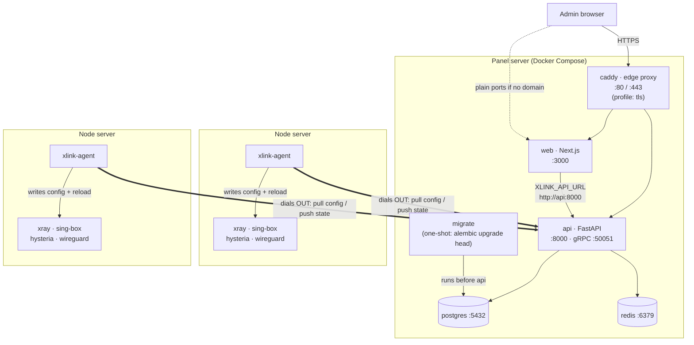
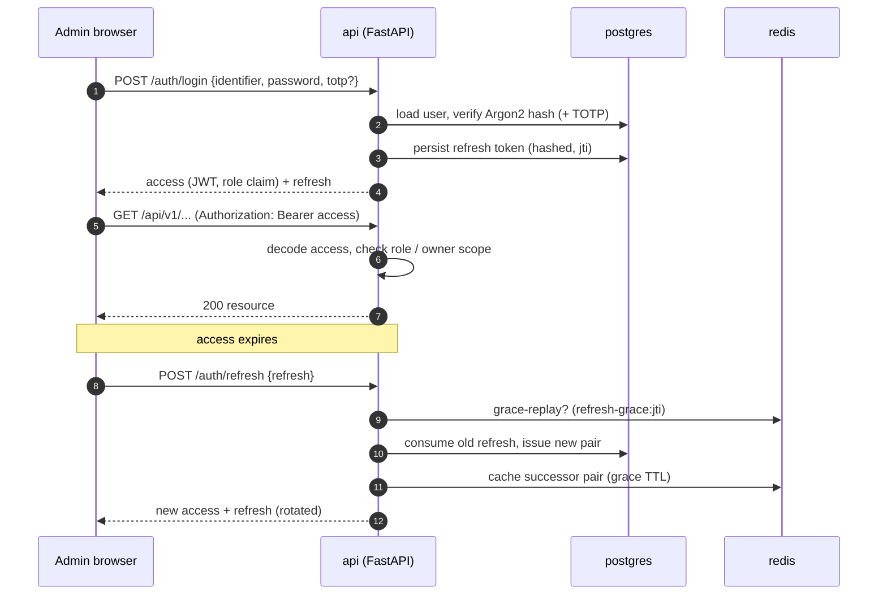
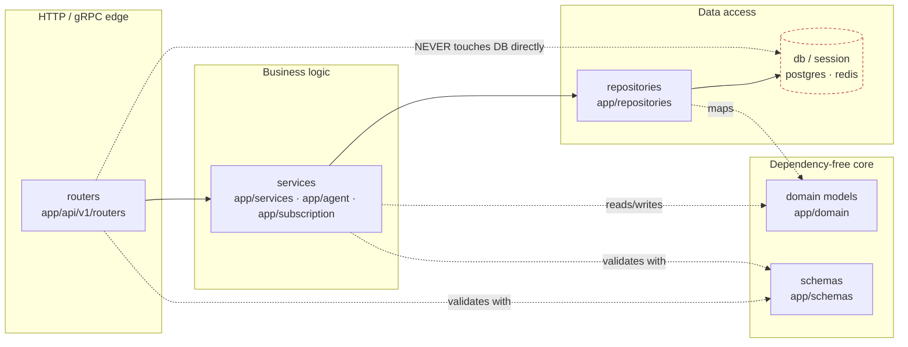
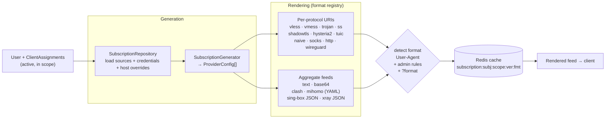
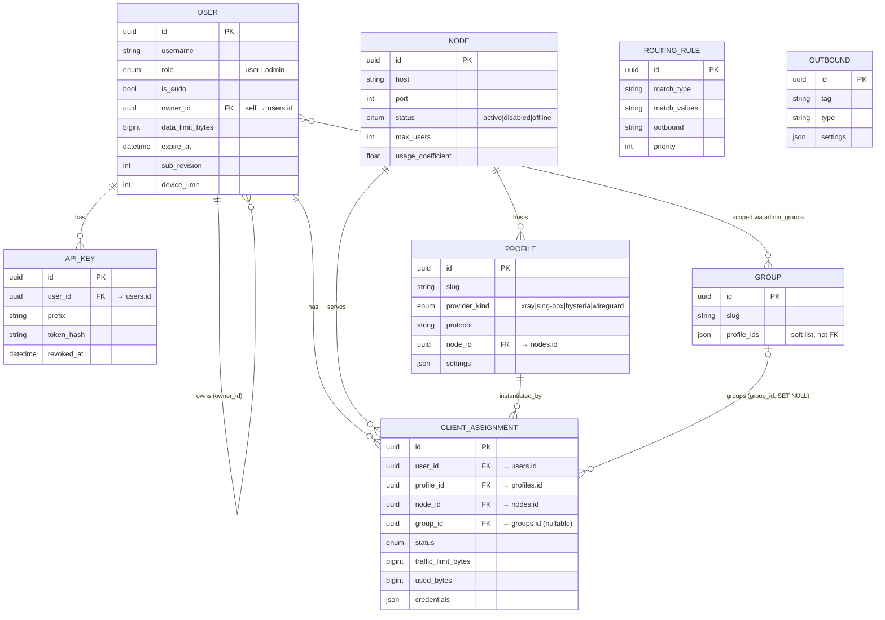
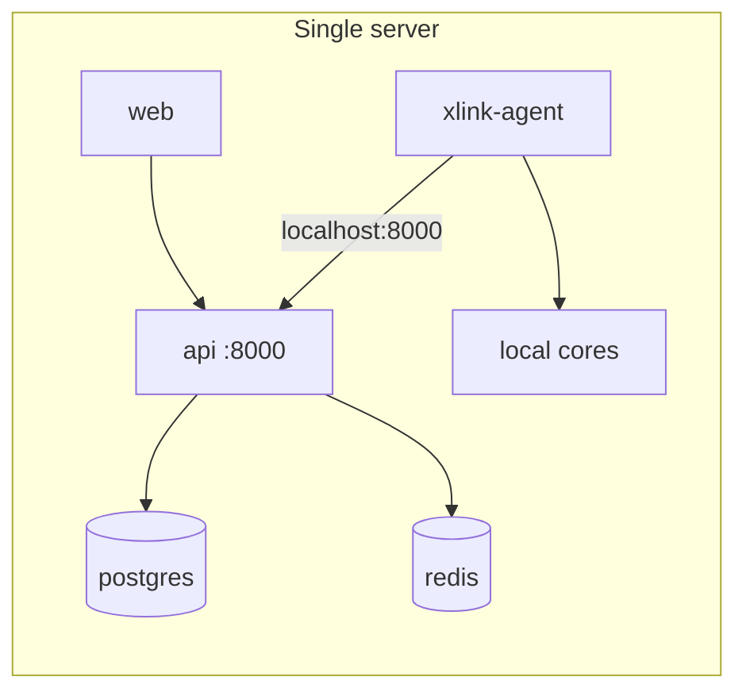
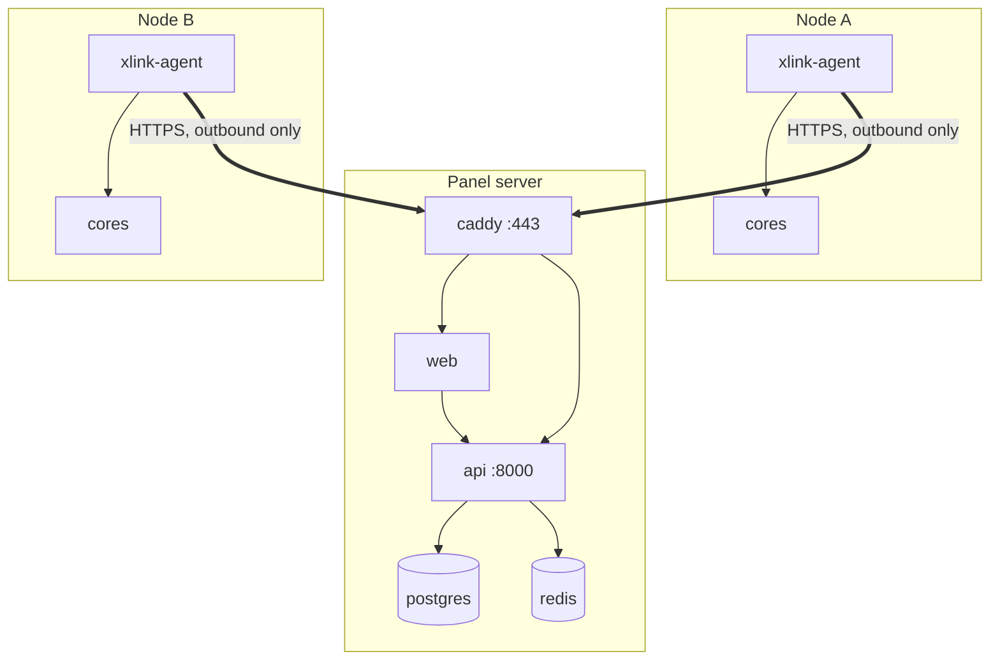

# XLink Architecture

XLink is a multi-node VPN management panel. A single control plane (FastAPI API,
Next.js console, PostgreSQL, Redis) manages a fleet of VPN nodes, each running a
small pull-based agent that talks *out* to the panel. This document describes the
system as it is built — services, request flows, backend layering, the node agent
cycle, the subscription pipeline, and the data model.

Every service name, port, path, and entity below is taken from the actual source
(`docker-compose.yml`, `app/`, `node-agent/xlink-agent.py`).

---

## 1. System overview

The panel runs as a Docker Compose stack. The browser talks to the Next.js
console (`web`, `:3000`), which proxies to the FastAPI backend (`api`, `:8000`,
plus optional gRPC `:50051`). The API is backed by PostgreSQL and Redis; a
one-shot `migrate` service runs Alembic to head before the API starts. `caddy` is
an edge proxy with automatic HTTPS, enabled only under the `tls` Compose profile
(turned on when a domain is configured).

The defining property: **the panel never dials into a node**. Each node runs
`xlink-agent`, which reaches *out* to the API over HTTPS — pulling its config,
applying it to the local cores (xray / sing-box / hysteria / wireguard), and
reporting back. A node only needs outbound reachability to the panel.



`api` depends on `postgres` (healthy), `redis` (healthy), and `migrate`
(completed). `web` waits for `api` to be healthy. Redis backs caching, the
subscription cache, refresh-token grace, IP-limit state, and the pub/sub channel
that wakes agents over SSE.

---

## 2. Request and auth flow

The console authenticates with a JWT access + refresh pair. `POST /auth/login`
verifies the password (Argon2, with a dummy-hash compare on the unknown-user path
to keep timing flat) and optional TOTP, then issues a pair. The short-lived access
token carries a `role` claim; the refresh token is persisted (hashed) and
**rotated** on every `POST /auth/refresh` — the old token is consumed and a new
pair minted. A brief Redis-backed grace window returns the same successor pair on
a replay, so a concurrent double-submit doesn't fork the token family while a real
theft still can't mint a live one.



Separately, a VPN client fetches a subscription with no JWT — it presents a signed
URL token. `GET /subscriptions/sub/{token}` decodes an HMAC-SHA256 token
(`app/subscription/tokens.py`: version + scope + user UUID + revision, signed with
`jwt_secret_key`), validates the signature in constant time, checks the token
revision against the user's `sub_revision` (so a link can be revoked), enforces
quota/expiry and device limit, then renders the feed in the format detected from
the client's User-Agent.

```mermaid
sequenceDiagram
    autonumber
    participant C as VPN client / browser
    participant A as api (/subscriptions/sub/{token})
    participant DB as postgres
    participant R as redis

    C->>A: GET /sub/{token} (User-Agent, X-Hwid?)
    A->>A: verify_subscription_token — HMAC-SHA256, decode scope+user+revision
    A->>DB: load user; check sub_revision == token revision
    alt revoked / expired / over quota
        A-->>C: 404 / status page / placeholder feed
    else valid
        A->>DB: register device (device_limit / HWID)
        A->>R: read cached feed (subscription:...)
        A->>A: detect format from User-Agent, render feed
        A-->>C: config feed (+ subscription-userinfo headers)
    end
```

---

## 3. Backend layering

The backend is layered on purpose: **routers → services → repositories → db**.
Routers (`app/api/v1/routers/`) parse and authorize requests and call services;
they never touch the database directly. Services (`app/services/`, `app/agent/`,
`app/subscription/`) hold the business logic and orchestrate repositories.
Repositories (`app/repositories/`) own all SQLAlchemy/session access. Domain
models (`app/domain/`) and schemas (`app/schemas/`) sit at the bottom and depend on
nothing above them — they stay dependency-free so the boundaries hold and the core
stays testable.

Authorization lives in `app/core/authz.py` (sudo vs. reseller-admin scoping,
secret-setting redaction); dependency wiring is in `app/dependencies/`.



The dashed red edge is the rule, not a real dependency: routers must go through a
service; the DB is reachable only via repositories.

---

## 4. Node agent cycle

`node-agent/xlink-agent.py` is a single-file pull agent. Each cycle it pulls the
desired config, applies it to the installed cores, collects per-user traffic,
reports state / traffic / metrics / logs, and leases and runs any operator
commands. Between full cycles a lightweight **fast-enforce** loop re-reads usage
and drops over-limit users within a few seconds, and an **SSE listener** on
`GET /events` wakes the cycle immediately when the panel publishes a change.

Traffic is durable and idempotent. Reading core stats *resets* the counters, so
deltas are written to a **write-ahead log** (`fsync`'d) *before* anything else;
they are only removed from the WAL after the panel acks them. The delivery batch
id is a deterministic hash of the WAL contents, so a re-sent unacked batch dedups
server-side instead of double-counting. Config is applied atomically — build to a
temp file, validate (`xray -test`, `sing-box check`), swap, reload, and roll back
to a backup on reload failure. Assignment ids that aren't UUIDs are dropped from a
batch so one bad sample can't 422 the whole delivery.

```mermaid
sequenceDiagram
    autonumber
    participant Ag as xlink-agent
    participant P as panel /agent/nodes/{id}
    participant Core as local cores
    participant W as traffic.wal (disk)

    loop every INTERVAL (or on SSE wake)
        Ag->>P: GET /config (X-Agent-Token)
        P-->>Ag: {config_version, clients[], core_templates}
        Ag->>Core: collect traffic (stats query + RESET)
        Ag->>W: append deltas + fsync (before reset takes effect)
        Ag->>Ag: local enforce (drop over-limit users)
        Ag->>Core: build → validate → swap → reload (rollback on fail)
        Ag->>P: POST /state {config_version, provider_status}
        Ag->>W: rotate WAL → claim oldest batch
        Ag->>P: POST /traffic {batch_id = hash(samples), samples}
        alt 200 OK
            P-->>Ag: ack
            Ag->>W: commit (drop delivered lines)
        else failure
            Ag->>Ag: keep in WAL, retry next cycle
        end
        Ag->>P: POST /metrics, /logs, /provider-health
        Ag->>P: POST /commands/lease
        P-->>Ag: {lease_token, commands[]}
        Ag->>Core: run command (restart / upgrade / apply_config)
        Ag->>P: POST /commands/result (retried; at-least-once)
    end

    Note over Ag,W: WAL = write-ahead log — no usage lost across crash/outage;<br/>deterministic batch id = idempotent, dedup-safe delivery
```

The agent speaks HTTP by default and can opt into gRPC (`XLINK_GRPC=1`,
`app/agent/grpc/`), transparently falling back to HTTP if gRPC is unavailable.

---

## 5. Subscription pipeline

A subscription feed is assembled from a user and their active client assignments.
The `SubscriptionRepository` loads the assignment sources (user → assignments →
profile + node + credentials), the `SubscriptionGenerator` turns each into a
normalized `ProviderConfig`, and the `SubscriptionRenderer` runs it through a
per-format renderer chosen from the format registry
(`app/subscription/formats/registry.py`). The output format is detected from the
client's User-Agent (with admin override rules and a `?format=` query override),
then cached in Redis keyed by subject/scope/version/format.

Per-protocol URI renderers exist for vless, vmess, trojan, shadowsocks, hysteria2,
tuic, socks, http, naive, and wireguard; aggregate renderers produce text (link
list), base64, sing-box JSON, Clash and Mihomo YAML, and xray JSON.



---

## 6. Data model

The core entities are backed by SQLAlchemy models in `app/domain/`. All primary
keys are UUIDs except `AppSettings` (a singleton `int`).

There is **no separate Admin table**. An admin is a `User` with `role = admin`;
`is_sudo` distinguishes a full sudo admin from a scoped reseller-admin. Ownership
is a **self-referential FK**: users a reseller-admin manages point back via
`owner_id`. A reseller-admin's group scope is the `admin_groups` many-to-many.

**`ClientAssignment` is the hub** — it hard-links a User, a Profile, and a Node
(and optionally a Group), and carries per-assignment credentials, quota, and usage.
`Profile` belongs to a `Node`. `RoutingRule` and `Outbound` are standalone
(consumed when building core configs). `Group.profile_ids` is a JSON soft-list of
profile UUIDs, not a relational FK.



Related tables not shown above: `InboundHost` (FK → `profiles.id`, self-FK
`chain_target_id`), `RefreshToken` and `UserDevice` (FK → `users.id`),
`UserTemplate`, `Certificate`, `AuditLog` (logical `actor_id`, no FK constraint),
`GitOpsRecord` (polymorphic `entity_id`/`entity_type`), and the `AppSettings`
singleton.

---

## Deployment topologies

**Single box.** The whole stack runs on one server: `api`, `web`, `postgres`,
`redis`, `migrate` (and `caddy` if a domain is set). A core (e.g. xray) plus the
agent can run on the same host, with the agent dialing `http://localhost:8000`.
Good for a small deployment or evaluation.



**Panel + nodes.** The panel stack runs on one server; each VPN location is a
separate node server running only the cores plus `xlink-agent`, which dials out to
the panel over HTTPS. Nodes need no inbound access from the panel and no SSH trust —
add or remove locations by provisioning an agent token and running the installer.
This is the intended production shape and the one that gives load-balancing and
automatic failover across the fleet.



**Multi-panel (HA).** Several panel replicas share one PostgreSQL and one Redis
behind a load balancer. Redis is the coordination bus (PasarGuard uses NATS for
the same job):

| Concern | Mechanism |
|---|---|
| Background jobs run once | `LeaderElector`: TTL'd Redis key with a unique id per process, renewed every TTL/3. A leader that cannot confirm its hold within 2/3 TTL stops claiming leadership locally, so a stalled process never overlaps the next leader. |
| Webhook / notification delivery | Durable queue (Redis Streams consumer group): each job goes to exactly one worker; crashed workers' jobs are reclaimed. |
| Config push to nodes | `publish_node_event` on Redis pub/sub; whichever replica holds the agent's stream forwards it. |
| Subscription cache | Redis revision counters plus durable invalidation markers. |
| Rate limits, refresh-token grace, setup token | Redis keys, so every replica sees the same state. |
| Auto-failover cooldown | Redis `SET NX` per node, so one outage triggers one failover across the cluster. |

Run any number of `XLINK_INSTANCE_ROLE=api` replicas and one or more `worker`
(or `all`) replicas; the elector keeps jobs single-instance.
